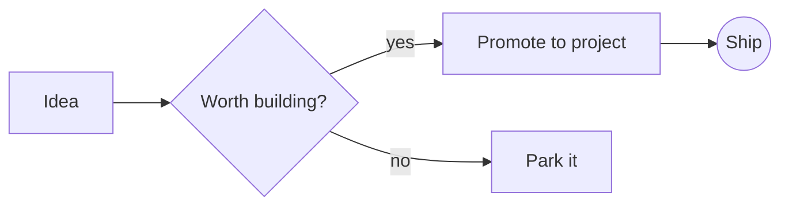
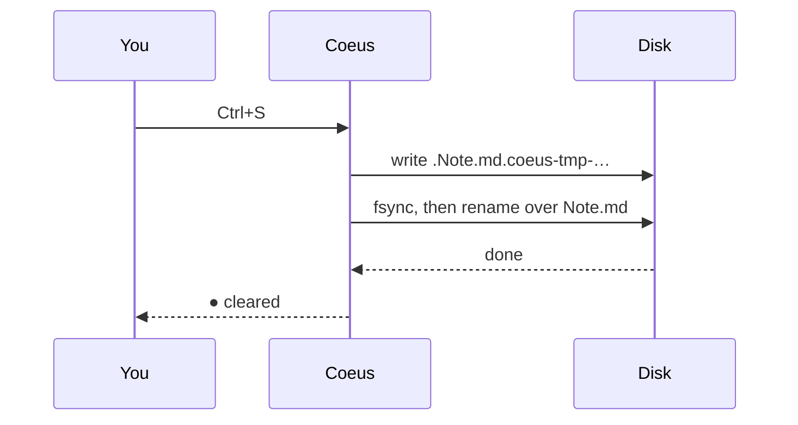
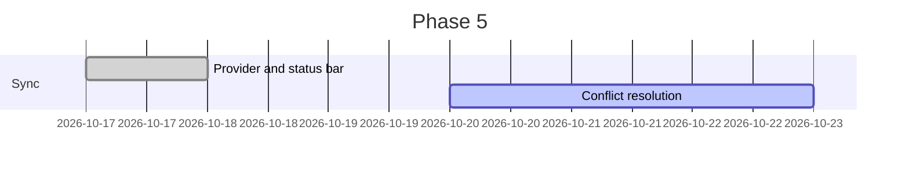

# Coeus User Manual

Coeus is a knowledge base for the Linux desktop. Your notes are plain Markdown files in an ordinary folder, the **vault**; Coeus reads them, links them, searches them and edits them, and keeps nothing of its own that it cannot rebuild from them. Delete Coeus tomorrow and every note is still there, readable in any text editor.

Beyond what a Markdown notes app usually does, Coeus has three things of its own:

- **Projects and registers.** It understands the project documentation standard (features, decisions, claims, attack vectors, bugs and improvements, each with an ID such as `D-007`) as records, not text: it numbers them, completes them, checks them and shows every project's state on a board.
- **Search by meaning.** Besides searching for words, it can find notes that are *about* what you ask, and shows the notes most related to the one you are reading.
- **Git.** Every note's history, any old version, differences between versions, line-by-line authorship and committing, without leaving the window.

This manual describes Coeus as of 2026-10-17. It is written to be read in order the first time and searched afterwards.

## Contents

1. [Getting started](#1-getting-started)
2. [The window](#2-the-window)
3. [Vaults, folders and files](#3-vaults-folders-and-files)
4. [Writing notes](#4-writing-notes)
5. [Markdown reference](#5-markdown-reference)
6. [Links, embeds and navigation](#6-links-embeds-and-navigation)
7. [Finding things](#7-finding-things)
8. [Tabs, panes and windows](#8-tabs-panes-and-windows)
9. [Projects and registers](#9-projects-and-registers)
10. [The project board and ideas](#10-the-project-board-and-ideas)
11. [Git](#11-git)
12. [Sync between machines](#12-sync-between-machines)
13. [AI sessions (MCP)](#13-ai-sessions-mcp)
14. [Appearance and keyboard](#14-appearance-and-keyboard)
15. [Settings reference](#15-settings-reference)
16. [Command line](#16-command-line)
17. [Keyboard shortcuts](#17-keyboard-shortcuts)
18. [Troubleshooting](#18-troubleshooting)

---

## 1. Getting started

### Installing

Coeus is built from source; [BUILD.md](../BUILD.md) lists the libraries it needs and how to build and test it. In short:

```bash
cmake -B build -G Ninja -DCMAKE_BUILD_TYPE=Release
cmake --build build -j
./build/coeus ~/notes
```

A few things are optional. Coeus runs without them and tells you, where it matters, what each would add:

| Optional | What it adds | How to get it |
|----------|--------------|---------------|
| The embedding model (67 MB) | Search by meaning and related notes | `python3 tools/fetch_model.py` once per machine |
| LaTeX and `dvisvgm` | Mathematics drawn as formulas | `sudo apt install texlive-latex-base texlive-latex-extra dvisvgm` (TeX Live) |
| Chrome or Chromium | Mermaid diagrams drawn as pictures | Any Chrome or Chromium on your `PATH` |
| `git` | Pushing after a commit | Your distribution's `git` package |
| rclone 1.66 or newer | Sync between machines | [rclone.org](https://rclone.org/install/) |

### Opening a vault

Any folder can be a vault: a folder of notes you already have, or an empty one.

```bash
./build/coeus ~/notes        # open ~/notes as the vault
./build/coeus                # start empty, then File › Open Vault… (Ctrl+O)
```

The first time Coeus opens a folder it creates a hidden `.coeus/` folder inside it for its index and settings, then reads every note. A few thousand notes take a few seconds; the status bar says `Indexing…` and then `index ok · N notes`. You can read and edit straight away; search, backlinks and the like fill in as the index catches up.

If the folder is a Git repository, Coeus offers once to add its own files to `.gitignore` (see [§3](#3-vaults-folders-and-files)).

### Trying everything at once

`tools/make_demo_vault.py` builds a demonstration vault that uses every feature in this manual, with a *Start here* note listing what to try:

```bash
python3 tools/make_demo_vault.py          # makes ~/CoeusDemo/vault and ~/CoeusDemo/pontus
./build/coeus ~/CoeusDemo/vault
python3 tools/make_demo_vault.py --force  # put it back as it was after experimenting
```

---

## 2. The window

```
┌───┬──────────────┬──────────────────────────────────┬────────────────┐
│ ▣ │ Explorer     │  Tab  Tab  Tab                   │ Sidebar        │
│ ⌕ │ Tags         │ ┌──────────────────────────────┐ │  Backlinks     │
│ ▤ │ Search       │ │ path ☆   Source Live Reading │ │  Related       │
│ # │ Bookmarks    │ │ ▸ Properties (3)             │ │  Graph         │
│ ⌘ │ Registers    │ │                              │ │  History       │
│ ◧ │              │ │   the note                   │ │  Outline       │
│   │              │ └──────────────────────────────┘ │                │
│   │              ├──────────────────────────────────┤                │
│   │              │ Problems │ Project Board         │                │
├───┴──────────────┴──────────────────────────────────┴────────────────┤
│ path        ✖ 2 ⚠ 1   ● 3 files changed   ⇅ synced   meaning ✓  … │
└──────────────────────────────────────────────────────────────────────┘
```

- **Tool strip** (far left): Explorer, Search, Project Board, Tags, Command Palette and Sidebar. Each button shows or hides its panel.
- **Left docks**, as tabs at the bottom of the left area: **Explorer** (your folders), **Tags**, **Search**, **Bookmarks** and **Registers**.
- **Centre**: the notes you have open, as tabs. It can be split into panes ([§8](#8-tabs-panes-and-windows)).
- **Sidebar** (right): sections that follow the current note: **Backlinks**, **Related**, **Graph**, **History** and **Outline**. Each section folds by clicking its title.
- **Bottom docks**: **Problems** and **Project Board**, hidden until you ask for them.
- **Status bar**: the current note's path, then on the right, as they apply: register problems (`✖ 2 ⚠ 1`), Git changes (`● 3 file(s) changed`), sync (`⇅ synced 14:05`), search by meaning (`embedding 120 of 340` or `meaning ✓`), the index (`index ok · 223 notes`) and the vault's folder. Most of them are buttons: click to act on what they show.

Every dock can be dragged elsewhere, floated, tabbed with another or closed; Coeus remembers the arrangement.

### The command palette

`Ctrl+P` opens the **command palette**: every command Coeus has, filtered as you type. The filter is fuzzy, so `nwnt` finds *New Note…* and `blame` finds *Toggle Blame*. Up and Down choose, Enter runs, Escape closes. The palette shows each command's shortcut, so it is also the quickest way to learn them.

---

## 3. Vaults, folders and files

### What is in a vault

```
my-vault/
├── Inbox.md                 notes, at any depth
├── projects/coeus/README.md
├── attachments/diagram.png  pictures, PDFs, audio, video
├── daily/2026-10-17.md      daily notes
├── templates/Meeting.md     templates
├── ideas/Theia.md           idea notes
├── Coeus properties.md      your own values for properties (optional)
├── .coeus/                  Coeus's own, on this machine only
│   ├── index.db             the index (safe to delete; it is rebuilt)
│   ├── config.toml          this vault's settings on this machine
│   ├── journal/             unsaved work, kept every 5 seconds
│   ├── bookmarks.json
│   ├── recent.json
│   ├── render/              drawn maths, diagrams and PDF pages
│   └── sync/                sync's records
└── .coeus-shared/
    └── embeddings.bin       search-by-meaning vectors, shared between machines
```

A **note** is any `.md` file. Everything else (pictures, PDFs, audio, video) is an **attachment**: notes can show or link to them.

`.coeus/` belongs to this machine and is never synced: each machine builds its own index. `.coeus-shared/` holds only data that is expensive to compute and safe to merge, the vectors behind search by meaning, so a second machine does not have to compute them again.

### How Coeus treats your files

Coeus is careful with your notes:

- **It changes a note only when you ask**: saving, or a command that says what it writes (New Note, a daily note, a template, Insert Next ID, and the like). Indexing, searching, Git and opening never write to your notes.
- **Every save is atomic.** Coeus writes a temporary file beside the note, makes sure it is on disk, and then swaps it into place. A crash or power cut leaves either the old note or the new one, never half of each. If a crash leaves a temporary file behind (`.Note.md.coeus-tmp-…`), Coeus removes it the next time it opens the vault.
- **It never overwrites a note someone else changed.** If the file changed on disk since you opened it, saving asks you what to do instead ([§4](#saving-and-conflicts)).
- **Unsaved work survives a crash.** Every five seconds Coeus copies changed buffers to its journal. If Coeus or the machine stops before you save, the next time you open the vault it offers to recover them.

### Git and `.coeus/`

When a vault (or the repository it is in) is a Git repository that does not already ignore Coeus's files, Coeus offers to add these lines to the vault's `.gitignore`:

```gitignore
# Coeus: machine-local index and files left by interrupted saves
.coeus/
.*.coeus-tmp-*
```

**Add to .gitignore** does it, **Not Now** asks again next time, and **Don't Ask Again** stops asking. File › Add Coeus Files to .gitignore does it on request at any time. Even without those lines, Coeus never counts its own files as changes or offers them for a commit.

### Linked roots

Your project repositories probably live outside the vault, under Git, while your notes live in the vault. **Linked roots** bring them in: Coeus indexes and shows them alongside the vault, as if they were inside it, without moving anything. List them in `.coeus/config.toml`:

```toml
[[roots]]
name = "coeus"
path = "~/Projects/Coeus"

[[roots]]
name = "pontus"
path = "/home/you/Projects/Pontus"
```

- **Names** use letters, digits, `.`, `_` and `-`, and must be different; `vault` is reserved for the vault itself.
- **Paths** may be absolute, start with `~/`, or be relative to the vault.
- The Explorer shows each root as its own section, and notes in a linked root are named `coeus/README.md`, `pontus/docs/DECISIONS.md` and so on.
- A root whose folder does not exist on this machine stays listed, greyed and marked *missing on this machine*; what Coeus knew of it is kept until it returns.
- Coeus honours each repository's `.gitignore`: ignored files and folders (build output, `node_modules`) are neither indexed nor watched.
- Linked roots are not synced by Coeus; they have their own sync, which is Git.

### Changes from outside

Coeus watches every folder of the vault and its linked roots. A note changed by another editor, by Claude Code, by a `git pull` or by sync is re-read within a fraction of a second, and an open tab follows it ([§4](#saving-and-conflicts)).

---

## 4. Writing notes

### Three ways to see a note

Every tab has a switch in its header: **Source | Live | Reading**.

- **Source** shows the Markdown exactly as written, in a fixed-pitch font, with syntax coloured.
- **Live** edits the same text but reads as the finished page: headings are large, `**bold**` is simply **bold**, links show their text, and pictures, tables, callouts, maths and diagrams are drawn in place. The line your cursor is on (or every line of a selection) shows its Markdown, so you always edit the real text. Moving into a table, callout or embed shows its source; moving out draws it again.
- **Reading** shows the rendered page, not editable. Links are followed with a click.

`Ctrl+E` switches between Reading and whichever editing mode the tab last used. **View › Default Mode** chooses the mode notes open in; Live at first.

In Source and Live, **Ctrl+click** follows a link (the pointer becomes a hand while Ctrl is held); a plain click just places the cursor.

Switching modes never changes the note.

### Creating notes

- **File › New Note…** (`Ctrl+N`) asks for the note's name, the root (when you have linked roots), the folder (starting from the one selected in the Explorer, else the current note's) and a template, *Blank* or any of yours. `.md` is added for you. **Create** stays greyed, with the reason shown, while the name is empty, contains `/`, starts with `.`, or names a note that exists.
- **Daily note:** `Ctrl+D` opens today's note, creating it first if needed ([below](#daily-notes)).
- **A link to a note that does not exist yet** is fine: it is shown as unresolved until you create the note.

### Saving and conflicts

`Ctrl+S` saves. A tab shows `●` while it has unsaved changes.

Before writing, Coeus checks the file has not changed on disk since you opened it. If it has (another editor, a sync, a `git checkout`), the save becomes a question:

- **Keep My Version** saves your text over the disk's.
- **Load Disk Version** replaces your text with the disk's.
- **Decide Later** leaves both as they are; the tab shows `⚠` and the next save asks again.

The same question appears, without saving, when a note open with unsaved changes is changed on disk. An open note with *no* unsaved changes simply reloads, keeping your place. A note deleted on disk while open keeps its text in the tab, marked as changed, and saving recreates it.

Closing a tab with unsaved changes asks **Save / Discard / Cancel**; quitting or opening another vault asks **Save All / Discard / Cancel**.

### Recovering unsaved work

Every five seconds Coeus copies each changed, unsaved buffer to `.coeus/journal/`. A save removes its copy. If Coeus stops before you save, the next time you open the vault it lists the notes it holds unsaved text for, flagging any changed or deleted since:

- **Recover** opens each with your unsaved text, still unsaved, so you can look before saving. A note changed on disk since will ask on save rather than overwrite.
- **Discard** throws the copies away.
- **Later** keeps them and asks again next time.

### Properties

The **Properties** card above the editor (in Source and Live) edits a note's frontmatter ([§5](#frontmatter)) as fields: one row per key, `Properties (3)` in its header. Text and numbers are line edits, dates must be `YYYY-MM-DD` and lists are comma-separated. **+ Add** adds a key. Editing a property edits the note's text, as one undo step, changing only that key's lines; save as usual. If the frontmatter is not valid YAML the card shows the parser's message and is read-only.

**Suggestions.** A text field offers, as you type, the values other notes already give that property, the most used first: type `Th` in `pov` and *Theo Hartmann* is offered.

**Your own values.** To give a property a fixed set of values, such as `status` for the scenes of a novel, list them in the note **`Coeus properties.md`** at the top of the vault. **File › Edit Property Values** opens it, creating it with an explanation the first time:

```markdown
# Coeus properties

The scenes' statuses, in the order I use them:

## status
Folders: Dead-Space-Book/prose
- outline
- draft
- revised
- final

## pov
- Theo Hartmann
- Ada Kerr
```

- Each **`##` heading** is a property's name, and the **list** under it its values, in the order the drop-down offers them.
- A **`Folders:`** line limits a list to the notes in those folders (comma-separated, named as the Explorer names them). Give the same property different lists for different folders; the list for the nearest folder above a note wins, and a list without `Folders:` applies everywhere else.
- Anything else in the note (explanations, other headings, code) is ignored, so write freely.

A property with a list becomes a drop-down. A value not in the list is shown as written with the allowed values and *as listed in Coeus properties.md*, counted in the header, and never changed until you choose one. Save the note and every open note's card follows at once. Because it is an ordinary note, it syncs with the vault, so every machine has the same lists.

Coeus has values of its own for one property only: `stage` in idea notes under `ideas/` takes the idea stages ([§10](#ideas)), unless you list your own. `status` is yours to use as you like; a project's status lives in its README's header ([§9](#what-makes-a-project)).

### Daily notes

`Ctrl+D` (File › Open Today's Note) opens today's note, creating it if needed. By default it is `daily/2026-10-17.md` and starts with `# 2026-10-17`. Settings in `.coeus/config.toml`:

```toml
[daily]
folder = "journal"                     # where daily notes go
format = "yyyy/MM/yyyy-MM-dd"          # a slash makes subfolders: journal/2026/10/2026-10-17.md
template = "templates/Daily.md"        # a template for new daily notes
```

The format uses Qt's date letters: `yyyy` year, `MM` month, `dd` day, `MMM` short month name, `ddd` short day name.

### Templates

Every `.md` file in the vault's `templates/` folder is a template (change the folder with `[templates] folder = "…"`). Use them three ways:

- **File › New Note…**, choosing the template.
- **File › Insert Template…** puts a template into the current note at the cursor. Into an empty note it goes whole; otherwise its body goes in at the cursor and its frontmatter keys are added where the note lacks them, existing keys untouched.
- As the template for daily notes.

Templates can contain **variables**, filled in when used:

| Variable | Becomes | Example |
|----------|---------|---------|
| `{{date}}` | today, `yyyy-MM-dd` | `2026-10-17` |
| `{{time}}` | now, `HH:mm` | `14:05` |
| `{{title}}` | the note's file name | `Weekly review` |
| `{{date:FORMAT}}` | today in any Qt date format | `{{date:dddd d MMMM}}` → `Saturday 17 October` |
| `{{time:FORMAT}}` | now in any Qt time format | `{{time:HH:mm:ss}}` |
| `{{next:KIND}}` | the project's next register ID ([§9](#9-projects-and-registers)) | `{{next:D}}` → the next free decision number |

A template's frontmatter may say where new notes from it belong, with `coeus-folder`; the key itself is removed from the note:

```markdown
---
coeus-folder: meetings
tags: [meeting]
date: {{date}}
---
# {{title}}

**Attendees:**

## Agenda

## Actions
- [ ]
```

---

## 5. Markdown reference

Coeus reads **CommonMark** with GitHub's extensions (tables, task lists, strikethrough, autolinks) and the Obsidian-style extensions most vaults use (wikilinks, embeds, tags, callouts, highlights, maths, Mermaid). Each feature below shows the Markdown you type and says how it looks in Reading and Live.

> Each example shows the Markdown you type in a code block. Most are followed by **Result**, the same Markdown left live, so opening this manual in Coeus (Reading or Live) shows exactly how it renders. Wikilinks, embeds, tags and block IDs are shown as source only, so this manual adds no links or tags to the index of a vault that includes it.

### Headings

```markdown
# Heading 1
## Heading 2
### Heading 3
#### Heading 4
##### Heading 5
###### Heading 6
```

Six levels, by the number of `#` (followed by a space). In Live, the `#`s disappear and the heading is drawn larger; the Outline lists every heading, nested by level. Headings are also link targets ([§6](#6-links-embeds-and-navigation)).

The underlined forms work too:

```markdown
Heading 1
=========

Heading 2
---------
```

### Paragraphs and line breaks

```markdown
A paragraph is one or more lines of text.
A line break inside a paragraph is kept as a line break.

A blank line starts a new paragraph.
```

Unlike strict CommonMark, Coeus shows a single line break as a break (as Obsidian does), so you can write poetry or addresses without trailing spaces.

### Emphasis

```markdown
*italic* or _italic_
**bold** or __bold__
***bold italic***
~~strikethrough~~
==highlighted==
```

**Result:** *italic*, **bold**, ***bold italic***, ~~strikethrough~~ and ==highlighted==.

Highlighting draws a background behind the text; it is a Coeus and Obsidian extension, so GitHub shows the `==` as written. In Live the markers vanish around what they style.

### Inline code

```markdown
Run `cmake --build build` and open `src/main.cpp`.
```

**Result:** Run `cmake --build build` and open `src/main.cpp`.

Text between backticks is shown in the fixed-pitch font, exactly as typed: nothing inside it is a link, tag or emphasis. To include a backtick, use two to fence it: ``` `` a `tick` `` ```.

### Code blocks

Fence code with three backticks (or three tildes), and name the language after the opening fence to have it coloured:

````markdown
```python
def greet(name: str) -> str:
    """Say hello."""
    return f"Hello, {name}!"   # an f-string
```
````

**Result:**

```python
def greet(name: str) -> str:
    """Say hello."""
    return f"Hello, {name}!"   # an f-string
```

Coeus colours keywords, types and built-ins, strings, comments and numbers in these languages, under these names:

| Family | Names that work |
|--------|-----------------|
| C, C++ and Objective-C | `c`, `cpp`, `c++`, `cc`, `cxx`, `h`, `hpp`, `objc` |
| Python | `python`, `py` |
| JavaScript, TypeScript, QML | `javascript`, `js`, `jsx`, `typescript`, `ts`, `tsx`, `qml` |
| Rust | `rust`, `rs` |
| Go | `go`, `golang` |
| Java, Kotlin, C# | `java`, `kotlin`, `kt`, `csharp`, `cs`, `c#` |
| Shell | `bash`, `sh`, `zsh`, `shell`, `console` |
| JSON | `json`, `jsonc` |
| YAML | `yaml`, `yml` |
| TOML and INI | `toml`, `ini` |
| SQL | `sql`, `sqlite` |
| CMake | `cmake` |
| Diffs | `diff`, `patch` (added and removed lines coloured) |

The name is matched in any case (`Python` works). Other languages, and code with no language, are shown plain in the fixed-pitch font. A few more examples:

````markdown
```cpp
#include <expected>
std::expected<int, QString> parse(const QString& text);   // C++23
```

```bash
for f in *.md; do echo "$f"; done
```

```diff
- old line
+ new line
```

```json
{ "name": "Coeus", "version": 1, "local": true }
```
````

**Result:**

```cpp
#include <expected>
std::expected<int, QString> parse(const QString& text);   // C++23
```

```diff
- old line
+ new line
```

In Live, a code block's fence lines fold away and the code is tinted; moving into it shows the fences. Nothing inside a code block is ever a link, tag or register ID.

Indenting by four spaces also makes a code block, without a language.

### Block quotes

```markdown
> A quotation.
> It can run over several lines,
>
> and several paragraphs.
>
> > Quotes nest.
```

**Result:**

> A quotation.
> It can run over several lines,
>
> and several paragraphs.
>
> > Quotes nest.

In Live the `>` is hidden. A quote that starts with `[!kind]` is a callout instead (below).

### Lists

```markdown
- An item
- Another, with a nested list:
  - nested item
  - another
    1. numbered inside
    2. and again
- `*` and `+` work as bullets too

1. First
2. Second
3. Third

7. A numbered list can start at any number
8. and continues from it
```

**Result:**

- An item
- Another, with a nested list:
  - nested item
  - another
    1. numbered inside
    2. and again
- `*` and `+` work as bullets too

1. First
2. Second
3. Third

Indent nested items to line up under the text of the item above (two spaces after `-`, three after `1.`).

### Task lists

```markdown
- [ ] Write the user manual
- [x] Build the graph view
- [ ] Set up the Raspberry Pi
  - [x] Buy an SSD
```

**Result:**

- [ ] Write the user manual
- [x] Build the graph view
- [ ] Set up the Raspberry Pi
  - [x] Buy an SSD

In Reading, tasks show as ☐ and ☑, and a list made only of tasks drops its bullets. Tick a task by changing `[ ]` to `[x]`.

### Tables

```markdown
| Feature        | Status      | Phase |
|:---------------|:-----------:|------:|
| Graph view     | Complete    |     4 |
| Sync           | In progress |     5 |
| Canvas         | Not started |     6 |
```

**Result:**

| Feature        | Status      | Phase |
|:---------------|:-----------:|------:|
| Graph view     | Complete    |     4 |
| Sync           | In progress |     5 |
| Canvas         | Not started |     6 |

The second row is the **delimiter row**; colons set each column's alignment: `:---` left, `:---:` centred, `---:` right. Use at least two dashes in a delimiter cell with a colon (`:--`, not `:-`), or the table is not recognised. Cells may hold emphasis, code and links; a literal `|` inside a cell is written `\|`. In Live a table is drawn as a table until the cursor enters it.

### Horizontal rule

```markdown
Above.

---

Below.
```

Three or more `-`, `*` or `_` on a line of their own, with a blank line above (otherwise `---` under text makes a heading).

### Links to web pages

```markdown
[Coeus on GitHub](https://github.com/Darian-Frey/Coeus)
[with a title](https://example.com "Shown on hover")
<https://example.com>
https://example.com and www.example.com become links by themselves
someone@example.com becomes an email link
```

**Result:** [Coeus on GitHub](https://github.com/Darian-Frey/Coeus), [with a title](https://example.com "Shown on hover"), <https://example.com>.

Clicking one (or Ctrl+clicking in an editing mode) opens it in your web browser.

### Links to files and notes by path

```markdown
[the plan](projects/plan.md)
[a section of it](projects/plan.md#Milestones)
[a spec with spaces](docs/My%20Spec.md)
[a PDF](attachments/spec.pdf)
```

A Markdown link to a local file is resolved **relative to the note it is written in**. Spaces in paths are written `%20`. `#Heading` after the path goes to that heading. These links count as links between notes everywhere (backlinks, the graph) exactly as wikilinks do, but they match by path only, never by title.

### Images

```markdown

![[diagram.png]]
```

Both forms show the picture. The first is standard Markdown, relative to the note; the second is the wikilink form ([§6](#how-embeds-are-shown)), found relative to the note and then anywhere in its root. Pictures are only loaded from inside the note's own root (the vault or the linked root it is in), never from elsewhere on disk or the web; a missing one shows its name in brackets. In Live a line holding only a picture shows the picture in place.

### Wikilinks

```markdown
[[Note title]]
[[Note title|text to show]]
[[Note title#A heading]]
[[Note title#^block-id]]
[[folder/Note title]]
[[pontus:DECISIONS]]
```

The most common way to link: the target is a note's title (its file name without `.md`), and Coeus finds it wherever it is ([§6](#6-links-embeds-and-navigation) explains how). An alias after `|` is the text shown. `#Heading` goes to a heading, `#^id` to a block, and `root:path` names a note in a linked root explicitly. Typing `[[` opens completion.

### Embeds

```markdown
![[Meeting notes]]
![[Meeting notes#Actions]]
![[Meeting notes#^decision]]
![[photo.jpg]]
![[spec.pdf]]
![[spec.pdf#page=3]]
![[recording.mp3]]
```

An embed is a wikilink with `!` in front: instead of linking, it shows the target in place. A whole note, one section of it (the heading and everything under it up to the next heading of the same or higher level), one block, a picture, a PDF page (the first, or `#page=N`), or for audio, video and other files a card that opens them in their usual application. Embeds may contain embeds, three deep. [§6](#how-embeds-are-shown) has the details.

### Block IDs

```markdown
We chose SQLite for the index because it needs no server. ^why-sqlite

- A list item can have one too ^first-item
```

A **block** is a paragraph or a list item. Ending it with a space and `^` followed by letters, digits and hyphens gives it an ID, which `[[Note#^why-sqlite]]` links to and `![[Note#^why-sqlite]]` embeds. The `^id` is hidden in Reading and Live. **Copy Block Link** (`Ctrl+Alt+L`) adds an ID for you and copies the link ([§6](#block-links)).

### Tags

```markdown
Some thoughts on #architecture and #project/coeus.

#reading/books #to-do #2026-plans
```

A tag is `#` followed by letters (in any script), digits, `_`, `-` and `/`, with at least one character that is not a digit. A `/` nests tags: `#project/coeus` is inside `#project`. Tags are matched without regard to case.

These are **not** tags: `# Heading` (a space after `#`), `#42` (only digits), `C#` and `issue#3` (the `#` follows a letter), anything in code or maths, and the `#heading` part of a link.

Tags can also go in the frontmatter, with or without `#`:

```yaml
---
tags: [architecture, project/coeus]
---
```

or `tags: architecture, project/coeus`, or one per line as a YAML list. The Tags pane lists them all ([§7](#tags-pane)).

### Frontmatter

```yaml
---
title: Weekly review
aliases: [Review, Weekly]
tags: [review, planning]
date: 2026-10-17
priority: 2
status: Active
reviewed: false
links:
  - "[[Roadmap]]"
---
# Weekly review
```

Frontmatter is YAML between two `---` lines at the very top of the note (`...` may close it too). Coeus reads each top-level key as a **property** and infers its type: a list, a date (`YYYY-MM-DD`), a number, or text (anything else, including anything in quotes). Special keys:

- **`aliases`** (or `alias`): other names for the note. `[[Review]]` above finds this note, and completion offers them.
- **`tags`**: tags, as above.
- **`stage`**: in an idea note under `ideas/`, one of the idea stages ([§10](#ideas)).
- **Any key** can be given values of your own in `Coeus properties.md` ([§4](#properties)); the Properties card then offers them and flags anything else.
- **`coeus-folder`**: in a template only, where new notes from it go.

In Reading the frontmatter becomes a table of properties; in Source and Live the Properties card edits it ([§4](#properties)). Frontmatter that is not valid YAML never stops a note opening: it is shown as a problem.

### Callouts

```markdown
> [!note]
> A plain note.

> [!tip] A title of your own
> Useful advice, with **formatting** and [[links]].

> [!warning]- Folded in Obsidian
> Coeus accepts the `-` (and `+`) and shows the callout open.
```

**Result:**

> [!note]
> A plain note.

> [!tip] A title of your own
> Useful advice, with **formatting**.

> [!danger] Careful
> Callouts can hold lists:
> - one
> - two

A callout is a block quote whose first line is `[!kind]`, optionally followed by a title (the kind is the title otherwise). It is drawn as a box with a coloured edge. The kinds Coeus colours:

| Kind | Colour |
|------|--------|
| `note`, `info` | blue |
| `tip`, `abstract` | teal |
| `example` | purple |
| `question` | gold |
| `warning` | orange |
| `danger` | red |
| `quote` | grey |

Any other kind is drawn blue. In Live a callout is drawn as a box until the cursor enters it.

### Mathematics

Coeus draws LaTeX mathematics when LaTeX and `dvisvgm` are installed ([§1](#installing)); otherwise it shows the source as code.

```markdown
Inline, within a sentence: the identity $e^{i\pi} + 1 = 0$ and the
roots $x = \frac{-b \pm \sqrt{b^2 - 4ac}}{2a}$ sit on the line.

On its own, centred:

$$
\int_0^\infty e^{-x^2}\,dx = \frac{\sqrt{\pi}}{2}
$$
```

**Result:** the identity $e^{i\pi} + 1 = 0$ and the roots $x = \frac{-b \pm \sqrt{b^2 - 4ac}}{2a}$ sit on the line, and

$$
\int_0^\infty e^{-x^2}\,dx = \frac{\sqrt{\pi}}{2}
$$

`$…$` is inline and `$$…$$` stands on its own. The `amsmath` and `amssymb` packages are loaded, so environments like these work:

```markdown
$$
\begin{aligned}
  f(x) &= (x + 1)^2 \\
       &= x^2 + 2x + 1
\end{aligned}
$$

$$
A = \begin{pmatrix} 1 & 2 \\ 3 & 4 \end{pmatrix}, \qquad
\det A = -2, \qquad
\mathbb{R}^n \supseteq \mathcal{B}
$$

$$
\sum_{k=1}^{n} k = \frac{n(n+1)}{2} \quad\text{and}\quad
\lim_{n \to \infty} \left(1 + \tfrac{1}{n}\right)^n = e
$$
```

**Result:**

$$
A = \begin{pmatrix} 1 & 2 \\ 3 & 4 \end{pmatrix}, \qquad
\det A = -2, \qquad
\sum_{k=1}^{n} k = \frac{n(n+1)}{2}
$$

Formulas are drawn in the theme's text colour at the interface's font size. If LaTeX reports an error, its first line is shown beside the source. In Live a `$$` block is drawn in place; inline `$…$` loses its dollar signs.

### Mermaid diagrams

Coeus draws [Mermaid](https://mermaid.js.org) diagrams when Chrome or Chromium is installed; otherwise it shows the source as code. A fenced block with the language `mermaid`:

````markdown

````

**Result:**


````markdown

````

**Result:**


````markdown

````

Flowcharts, sequence diagrams, class and state diagrams, Gantt charts, pie charts, mind maps and the rest of Mermaid 11 work. Diagrams follow the theme: neutral in light themes, dark in dark ones, amber in Cassette. A diagram Mermaid cannot read shows Mermaid's error in its place. Drawing happens in the background (the source shows meanwhile) and is kept, so a diagram is drawn only once until it or the theme changes. Mermaid runs with nothing from outside allowed in: no links to other sites, no scripts.

### Escaping

```markdown
\*not italic\*   \# not a heading or tag   1\. not a list   \`not code\`
```

A backslash before a punctuation character shows the character itself.

### What is not supported

- **Raw HTML** is shown as text, never run: `<b>hi</b>` appears as written. This keeps notes from other places safe to open.
- **Footnotes** (`[^1]`) and **comments** (`%% … %%`) are shown as written.
- **Embedded picture sizes** (`![[pic.png|300]]`) are not applied; pictures are shown at their size, never wider than the view.
- In Obsidian a callout written `[!kind]-` starts folded; Coeus shows it open.

---

## 6. Links, embeds and navigation

### How a wikilink finds its note

When you write `[[Plan]]`, Coeus looks in this order and takes the first match:

1. A note whose path matches exactly (`[[projects/plan]]`), in the same root as the note with the link; or a note named with its root (`[[pontus:DECISIONS]]`).
2. A note titled *Plan* in the same folder as the note with the link.
3. A note titled *Plan* elsewhere in the same root, nearest folder first.
4. A note titled *Plan* in another root, nearest first.
5. A note with *Plan* among its `aliases`, same root first.

If nothing matches, the link is **unresolved**: a new note waiting to be written. If two notes match equally well, it is **ambiguous**. Coeus never guesses: clicking an unresolved or ambiguous link says so in the status bar, and the link shows nowhere as a backlink. Completion always inserts a link that reaches exactly the note you chose, adding the folder (or root) when the title alone would be ambiguous.

### Completion

Typing `[[` opens a list of notes, narrowing as you type (fuzzy, so `mtg nts` finds *Meeting notes*). Titles and aliases are both offered; an alias inserts `[[Note|Alias]]`.

- After `[[Note#` it lists that note's **headings**; `[[#` lists the current note's.
- After `[[Note#^` it lists that note's **block IDs** with the start of each block's text.
- Typing a register ID (`D-`, `AV-0`, `BUG-`) in a project's note lists that project's entries with their titles and statuses ([§9](#id-completion)).

Up and Down choose, Enter or Tab inserts, Escape closes. If `]]` already follows the cursor it is reused.

### Following links

In Reading, click a link. In Source or Live, Ctrl+click it. A link to a heading or block opens the note with that line at the cursor (or tells you if the heading or block is gone). A link to a web page opens your browser; a link to a PDF, picture or other attachment opens it in its usual application.

### How embeds are shown

`![[…]]` shows its target in place, in Reading and in Live:

- **A note** (`![[Note]]`) shows its body, without its frontmatter, in a framed block whose title links to it.
- **A section** (`![[Note#Heading]]`) shows that heading and what follows it, up to the next heading of the same or a higher level.
- **A block** (`![[Note#^id]]`, or `![[Note^id]]`) shows that paragraph or list item.
- **A picture** shows the picture; **a PDF** shows a page, the first or `#page=N`, linked to the file.
- **Anything else** (audio, video, a canvas) shows a card, such as `[PDF] spec.pdf`, that opens the file.

An embed is found exactly as the link would be. Embeds nest three deep; anything that cannot be shown (a note embedding itself, a missing heading, an unresolved target) shows as a link with the reason. When the embedded note changes, the embed follows once the change is indexed. In Live, embeds taller than 480 pixels are cut with a `⋯`.

### Block links

**Copy Block Link** (`Ctrl+Alt+L`, also in the editor's right-click menu) copies a link to the paragraph or list item under the cursor, such as `[[Meeting notes#^k3x9qa]]`. If the block has no ID yet, Coeus adds a short random one to its end first (as an ordinary edit, which you then save). Paste the link anywhere; put `!` in front to embed the block.

### Backlinks and unlinked mentions

The sidebar's **Backlinks** section lists every note that links to the current one, from any root, grouped by note, each with the line the link is on (`↪` marks an embed). Click one to open that note at that line.

**Unlinked mentions**, below it, lists lines that mention the current note's title or aliases (three characters or more) as plain words without linking to it: candidates for a link. Code, links and frontmatter are ignored.

### Outline

The sidebar's **Outline** shows the current note's headings, nested, including unsaved ones. Click a heading to jump to it; the heading of the section you are in is highlighted as you move.

---

## 7. Finding things

### Search

`Ctrl+Shift+F` opens the **Search** pane. Results appear as you type, best first, each with its matches highlighted; open one to land on the first match.

| Query | Finds notes… |
|-------|--------------|
| `sqlite` | containing a word starting with *sqlite* (title matches rank first) |
| `sqlite index` | containing both |
| `"atomic write"` | containing the exact phrase |
| `sync -rclone` | containing *sync* but not *rclone* |
| `sync -"google drive"` | containing *sync* but not the phrase |
| `tag:project` | tagged `#project` or anything under it (`#project/coeus`) |
| `path:projects/coeus` | under that folder (a linked root: `path:pontus/`) |
| `file:readme` | whose title contains *readme* |
| `re:/D-0\d{2}/` | whose text matches the regular expression |
| `tag:meeting "action items" -done` | all of these together |

Everything is combined with AND. Words match as prefixes, so results show while you are still typing.

#### By meaning

The switch beside the query chooses **Words** (as above), **Meaning** or **Both**.

- **Meaning** finds notes about what you ask, whatever words they use: *how do I stop losing work after a crash* finds the notes on the autosave journal. Each result names the passage that matched (`note › heading`) and opens at it.
- **Both** combines the two rankings, so a note found both ways comes first.

Search by meaning needs the embedding model, fetched once per machine with `python3 tools/fetch_model.py`. Coeus then works through your notes in the background (`embedding 120 of 340` in the status bar, then `meaning ✓`); a few thousand passages take a few minutes the first time, and after that only what changes is re-done. Without the model everything else works and the status bar says `no embedding model`.

### Related notes

The sidebar's **Related** section lists the five notes nearest in meaning to the current one that it does not already link to, each with the passage that matched. **Link here** puts a link to that note at your cursor. It needs the embedding model, and ignores the boilerplate every project shares (status headers and register preambles), so it shows notes that are genuinely related.

### Tags pane

The **Tags** pane (`Ctrl+Shift+T`) lists every tag, nested on `/`, with how many notes carry it or anything under it. A box at the top filters the list. Click a tag to show its notes in the Explorer in place of the folders, under a `#tag · N notes` banner; **Clear** brings the folders back.

### Graph view

`Ctrl+G` (View › Open Graph View) opens a tab showing your notes as dots and your links as lines, arranged by a simulation that pulls linked notes together and pushes the rest apart until it settles.

- **Colour by** project (each project's notes share a colour; notes outside projects are grey) or by tag (each note's first tag), with a legend.
- **Tags** shows each tag as a dot of its own, joined to its notes. **Orphans** adds notes with no links. **Unresolved** adds hollow dots for notes linked to but not written yet. **Linked roots** adds the notes of your project repositories.
- Drag the background to move around and the mouse wheel to zoom; drag a dot to move it; hover over one to light up its links and fade the rest. Click a note to open it, or a tag to filter the Explorer by it. **Fit** (or double-clicking the background) fits everything in view again.
- Larger dots have more links. Labels show for the busiest notes and for whatever you hover; zoom in to see them all.

The sidebar's **Graph** section is the **local graph**: just the current note and what is within **Depth** links of it (1 to 3). Your choices for each are remembered.

### Bookmarks

Star a note with the ☆ in its header or `Ctrl+Alt+S`; star a search with the ☆ beside the Search pane's query (it remembers the mode). The **Bookmarks** pane (`Ctrl+Shift+K`) lists them in the order starred: click a note to open it, or a search to run it again. Right-click to move one up or down or remove it, or press Delete. A starred note that has been deleted stays listed, struck through, until you remove it.

### Recent notes

`Ctrl+R` lists the 30 notes you opened most recently, newest first, with the current one last so that Enter takes you back to the previous note. File › Open Recent shows the same as a menu. Bookmarks and recent notes are kept per vault and per machine.

---

## 8. Tabs, panes and windows

### Tabs

Each open note is a tab: `●` means unsaved changes, `⚠` a conflict waiting for a decision. A note is open in one place only: opening it again goes to its tab. `Ctrl+W` closes a tab. Versions, comparisons and the graph also open as tabs.

### Panes

Split the centre to see notes side by side:

- **Split Right** (`Ctrl+\`) and **Split Down** (`Ctrl+Shift+\`) add a pane beside or below the current one; the current note moves into it if its pane has another, otherwise the new pane is empty, ready for the next note you open.
- **Move Tab to Next Pane** (`Ctrl+Alt+M`) and **Focus Next Pane** (`Ctrl+Alt+O`) move between them.
- New notes open in the pane you last clicked in, and the sidebar follows that pane's note.
- A pane goes when its last tab closes. Drag the dividers to resize.

### Windows

**Move to New Window** (`Ctrl+Alt+W`) moves the current note, with its unsaved text, into a window of its own, with its own docks, to put on another monitor. Every window on a vault shares one index, one set of bookmarks and recent notes, and one sync; a note open in one window is shown there when another asks for it. A second window remembers its own layout. Closing a window asks only about its own notes; **File › Quit** (`Ctrl+Q`) closes them all.

Open tabs and panes are not restored when Coeus restarts; the window's size and dock layout are.

---

## 9. Projects and registers

Coeus understands a documentation standard for software projects. You do not need it to use Coeus as a notebook; skip to [§11](#11-git) if you have no projects.

### What makes a project

A **project** is any folder (in the vault or a linked root) whose `README.md` begins with this four-line status header:

```markdown
> **Status:** Active
> **Provenance:** Shane Hartley; started 2026-09-25
> **Last reviewed:** 2026-10-17
> **Why this status:** Phase 5 in progress.

# Coeus
```

**Status** is one of *Active, Dormant, Complete, Archived, Superseded*. Every note under the folder belongs to the project, unless a deeper folder is a project of its own. A linked repository whose top-level README has the header is a project too.

### Registers

A project keeps its records in register files, each a list of numbered entries:

| File | Kind | Records |
|------|------|---------|
| `FEATURES.md` | `F-` | features: what the software should do |
| `CLAIMS.md` | `C-` | claims: statements to test |
| `DECISIONS.md` | `D-` | decisions, with the options weighed |
| `ATTACK_VECTORS.md` | `AV-` | ways things could go wrong |
| `BUGS.md` | `BUG-` | bugs |
| `IMPROVEMENTS.md` | `IMP-` | improvement candidates |

A register file counts anywhere in the project (`docs/DECISIONS.md` too). An **entry** starts at a level-3 heading with its ID and title, and holds **fields**: a bold name and a colon for one-line fields, a bold name and a full stop for paragraphs:

```markdown
### D-012 Use SQLite for the index
**Decided:** 2026-10-02
**Recorded:** 2026-10-02
**Status:** Accepted
**Authors:** Shane Hartley
**Related:** F-006, AV-001

**Context.** The index must be rebuildable and need no server.

**Options.**
- **A. SQLite.** One file, full-text search built in.
- **B. A search server.** More to run.

**Decision.** Option A.

**Consequences.**
- The index is a single file in `.coeus/`.

**Reversal conditions.** Revisit if search over 100,000 notes is too slow.
```

IDs have at least three digits, are never reused and never renumbered. The **Related** field (and fields named *Related decisions*, *Related claims* and so on) lists the entries this one cites.

Each kind's fields, as Insert Next ID creates them:

```markdown
### F-031 Title
**Priority:** Should
**Acceptance:**
-
**Status:** Not started

### C-004 Title
**Status:** Proposed
**Domain:** Empirical
**Authors:**
**Related:**

**Statement.**

**Falsification conditions.**

**Current evidence.**

**Reversal conditions.**

### AV-013 Title
**Severity:** Major
**Description.**
**Detection.**
**Related decisions.**
**History.** Identified 2026-10-17.

### BUG-013: Title
**Status:** open
**Severity:** medium
**Found:** 2026-10-17
**Location:**
**Description.**
**Reproduction.**
**Notes.**

### IMP-006: Title
**Status:** suggested
**Found:** 2026-10-17
**Location:**
**Effort:** small
**Description.**
**Proposal.**
**Trade-offs.**
**Notes.**
```

The allowed values (case matters):

| Field | Values |
|-------|--------|
| Project status | Active, Dormant, Complete, Archived, Superseded |
| Feature status | Not started, In progress, Complete, Withdrawn |
| Feature priority | Must, Should, Could, Won't |
| Claim status | Proposed, Supported, Refuted, Withdrawn |
| Claim domain | Empirical, Theoretical, Mathematical |
| Decision status | Proposed, Accepted, Superseded by D-NNN, Deprecated |
| Attack vector severity | Critical, Major, Minor |
| Bug status | open, fixed, wontfix, deferred |
| Bug severity | low, medium, high |
| Improvement status | suggested, applied, declined, deferred |
| Improvement effort | trivial, small, medium, large |
| Roadmap phase status | Not started, In progress, Complete |

A value may be followed by a qualifier: `fixed (2026-10-05)`, `Complete (Phase 2, 2026-10-13): …` and `applied 2026-09-23` are all fine; `Done`, `Completed` and `Medium` are not.

### Insert Next ID

**Insert Next ID…** (`Ctrl+Shift+I`) adds a new entry: choose the kind, and Coeus works out the next free ID for the project (counting unsaved entries and anything another process just took), creates the register file if the project has none, opens it, adds the kind's skeleton at the end and selects *Title* so you can type over it. Save as usual. Two people, or you and an AI session, can never be given the same ID.

In a template, `{{next:D}}` (or any kind) becomes the project's next ID when the template is used in a project's note, so a "new decision" template can number itself.

### ID completion

In a project's note, typing an ID such as `D-` or `AV-01` opens completion with that project's entries of that kind, their titles and statuses. Choose one to insert the ID.

### The Registers pane

The **Registers** pane (a tab beside the Explorer) lists one project's entries: choose the project (it follows the note you are on), filter by kind and status, and type to filter by ID or title. Click an entry to open its register at its line.

### Problems and the lint

Coeus checks every project's registers as you work and lists what it finds in the **Problems** panel (`Ctrl+Shift+M`), with a count in the status bar (`✖ 2 ⚠ 1`); click a problem to go to it. In the editor, problems are underlined: red for errors, amber for warnings, blue for information, with the message on hover.

| Rule | Level | Means |
|------|-------|-------|
| L1 unresolved-ref | error | a Related field cites an ID the project does not have |
| L2 stale-ref | warning | a Related field cites an entry that is superseded, withdrawn, refuted, deprecated, wontfix or declined |
| L3 bad-vocab | error | a status, priority, domain, severity or effort is not one of the allowed values |
| L4 one-way-ref | warning | an entry mentions another, and the standard expects the other to mention it back |
| L5 missing-reversal | error | a decision or claim has no *Reversal conditions* |
| L6 missing-tradeoffs | error | an improvement has no *Trade-offs* |
| L7 missing-detection | error | an attack vector has no *Detection* |
| L8 stale-review | info | the project's *Last reviewed* is older than 14 days, or not a date |
| L9 duplicate-id | error | the same ID is used twice in the project |

**Copy Report** in the Problems panel copies what it shows as Markdown, ready to paste into an issue or an AI session:

```markdown
# Register problems: projects/coeus

2026-10-17 · 1 error(s) · 1 warning(s) · 0 info, from Coeus's register lint (F-016). Paths are relative to the project folder.

## DECISIONS.md

- `DECISIONS.md:412` error L1: D-019 cites F-099, which does not exist in this project
- `DECISIONS.md:550` warning L4: D-024 cites AV-005, but AV-005 does not cite D-024

## Rules

- L1: a Related field cites an ID the project does not define.
- L4: …
```

The same check runs from a terminal, for scripts and Git hooks ([§16](#16-command-line)).

---

## 10. The project board and ideas

### The project board

The **Project Board** (`Ctrl+Shift+J`) lists every project and idea in the vault and linked roots, worked out from the files, never kept by hand:

| Column | For a project | For an idea |
|--------|---------------|-------------|
| Name | its folder (`root/folder` in a linked root) | its codename or title |
| Status | the README's status | its stage |
| Reviewed | days since *Last reviewed*, amber past 14 days | — |
| Build | the current phase from ROADMAP.md and how many are complete | its summary |
| Unreleased | entries under `## [Unreleased]` in CHANGELOG.md | — |
| Git | branch, `↑ahead ↓behind`, `●` changed files | its repository |

Click a row to open the README or idea. Right-click a project for **Refresh Header…**, which sets *Last reviewed* to today after asking. **Fetch** runs `git fetch` in every project's repository so the ahead and behind counts are current; it only runs when you click it.

### Ideas

An **idea** is a note in the vault's `ideas/` folder whose frontmatter has a `stage`:

```yaml
---
stage: scoped        # idea | scoped | building | shipped | parked
codename: Theia
repo:                # a GitHub address or linked root, once there is one
summary: A star-chart companion for the vault's graph.
---
# Theia

What it is, why, and what would make it worth building.
```

Ideas appear on the board by stage. Right-click one and choose **Promote Idea…** to turn it into a project: give it a codename and a place (`projects/<codename>/` in the vault, or a folder outside it, which then becomes a linked root), and Coeus writes a README with the status header and the idea's text, plus empty FEATURES, ROADMAP, DECISIONS, CLAUDE and CHANGELOG files, and only then removes the idea note.

---

## 11. Git

Coeus reads and commits Git repositories directly, for notes in the vault and in linked roots. Each note uses the repository it is in. Nothing here ever changes your files: reading writes nothing, and committing writes only inside `.git/`.

### History

The sidebar's **History** section shows the current note's branch and every commit that changed it, newest first, following it across renames, with the full message on hover. It refreshes when you come back to the window, so commits made in a terminal show up.

- **Click a commit** to open the note as it was then, in a read-only tab named `Note @ a41c9e2`.
- **Right-click a commit** for **Compare with the Version Before** or **Compare with the Working Copy**; select two (Ctrl+click) for **Compare These Two Versions**.

### Comparing versions

**Diff with HEAD** (`Ctrl+Alt+D`, or History's *Diff vs HEAD*) compares the last commit with what you have now, unsaved changes included. A comparison opens as a tab showing the whole note, with removed lines in red marked `−` and added lines in green marked `+`, old and new line numbers, and ↑ ↓ buttons to move between changes.

### Blame

**Toggle Blame** (`Ctrl+Alt+B`, or History's *Blame*) opens a margin beside the text naming, for each run of lines, the commit and date that last changed it, with the author and summary on hover. Lines you have changed since show *Not committed*. It follows your edits as you type.

### Committing

The status bar counts the changed files in the current note's repository (`● 3 file(s) changed`). Click it, or **Commit…** (`Ctrl+Alt+C`), to commit:

- Every changed file is listed with its status (`M` modified, `A` added, `D` deleted, `R` renamed, `?` new and untracked) and a tick. Changed notes start ticked; other new files start unticked.
- Notes open with unsaved changes are named, with **Save All**, since a commit takes files as they are on disk.
- Write a message and click **Commit**. Exactly the ticked files are committed, as your Git identity (`user.name` and `user.email`). Git hooks do not run.
- **Push after committing** (remembered) runs `git push` in the background afterwards; the result shows in the status bar, and a failure (no network, no credentials) never interrupts you.

---

## 12. Sync between machines

Sync keeps the vault the same on two or more machines through **rclone**, which can reach Google Drive, an SFTP server (such as a Raspberry Pi at home), a NAS, Dropbox and dozens more. Only the vault is synced: `.coeus/` stays on each machine, linked roots are left to Git, and `.coeus-shared/` travels so a second machine need not recompute search by meaning.

> Sync is new. It syncs and keeps every version safe, but resolving a conflict from inside Coeus is still to come: for now you compare the two files and keep what you want yourself.

### Setting it up

1. Install rclone 1.66 or newer: `sudo -v ; curl https://rclone.org/install.sh | sudo bash`.
2. Add a remote with `rclone config`, for example an `sftp` remote named `pi` for a Raspberry Pi over SSH, or a `drive` remote named `gdrive`.
3. In Coeus, **File › Set Up Sync…** and give the remote and a folder on it, as rclone names them:

   ```text
   pi:/srv/coeus            an SFTP server
   gdrive:Coeus             Google Drive
   /mnt/nas/coeus           a folder that is always mounted
   ```

   Leave it empty to turn sync off on this machine.
4. The first sync asks to **Join** the vault and the remote ([below](#joining)).

From then on Coeus syncs five seconds after opening the vault, every five minutes, and whenever you choose **File › Sync Now** (`Ctrl+Alt+Y`). Syncing happens in the background.

### The status bar

| Shows | Means | Clicking it |
|-------|-------|-------------|
| `⇅ syncing…` | a sync is running | — |
| `⇅ synced 14:05` | the last sync finished then | syncs now |
| `⇅ join the remote?` | this machine has not synced with the remote yet | asks to join |
| `⇅ sync stopped` | rclone stopped because too much would change | asks what to do |
| `⇅ no rclone` | rclone is missing or too old | — |
| `⇅ sync failed` | something else went wrong; hover for rclone's words | syncs again |
| `· ⚠ 2 conflicts` | two notes have another version waiting | lists them |

### Joining

The first time a machine syncs with a remote, Coeus asks before joining them: files on only one side are copied to the other, and where both have a file and they differ, this machine's copy stays and the remote's is kept beside it as a conflict copy. Nothing is lost, even if one machine holds an old copy of the vault.

### Conflicts

If the same note changes on two machines between syncs, the machine that syncs second keeps its own version as the note, and the other version arrives beside it as `Note.md.conflict1` (`conflict2` and so on if there are more), on every machine. Both versions are always kept. The status bar counts these and lists them when clicked. To resolve one, compare the two, put what you want in the note, save it, and delete the `.conflict1` file.

A note you have open with unsaved typing is never overwritten: if sync brings a new version of it, the editor's conflict question appears ([§4](#saving-and-conflicts)) and your typing stays in the editor.

### When sync stops

rclone refuses to carry on when every file, or more than half of them, would change or be deleted at once, which is what a mistake looks like (an emptied folder, a disconnected disk). Coeus then asks: if you did it on purpose (moving a folder, say), choose **Sync Anyway**; if not, look at the vault and the remote first.

---

## 13. AI sessions (MCP)

Coeus can serve your vault to an AI session through the Model Context Protocol, so Claude Code (or Claude Desktop, or a local model through LM Studio) can search your notes, read them and the projects' registers, and with your permission write to them. The AI uses the same index you do.

### Connecting Claude Code

Once per machine, after building Coeus:

```bash
claude mcp add --scope user coeus -- "$HOME/Projects/Coeus/build/coeus" --mcp --vault "$HOME/Projects"
claude mcp list            # coeus should show as connected
```

Start a new Claude Code session afterwards; `/mcp` lists the server. [BUILD.md](../BUILD.md#mcp-server) shows the setup for Claude Desktop and LM Studio.

### What the AI can do

| Tool | What it does |
|------|--------------|
| `search` | search by words, by meaning, or both |
| `related` | the notes related to a note |
| `get_note` | a note's text, properties, links and backlinks |
| `list_registers` | a project's register entries, filtered by kind and status |
| `problems` | the lint problems, as in the Problems panel |
| `project_status` | every project's status, phase, changelog and Git state |
| `list_ideas` | the ideas and their stages |
| `next_id` | reserve the next ID of a kind |
| `append_entry` | add a register entry, checked against the standard |
| `write_note` | create, replace or append to a note |

The last three **write**, and refuse until you allow them in the vault's `.coeus/config.toml`:

```toml
[mcp]
allow_writes = true
```

With the Coeus window open, the AI cannot write to a note you have open with unsaved changes, and every write shows a notice over the editor naming what changed, with **Undo** for ten seconds. Undo only puts the note back if nothing else has changed it since.

---

## 14. Appearance and keyboard

### Themes

**View › Theme** offers:

- **System**: your desktop's own look (the default).
- **Light** and **Dark**: Coeus's own, the same on any desktop.
- **Dark Cyan**: the look Coeus was designed in. Three shades of near-black (the window's edges, the panels, the note itself), soft grey text, teal links and accents, amber warnings, flat rounded controls and hairline rules, and callouts filled with a faint wash of their own colour.
- **Cassette**: an amber CRT terminal, warm black with amber text and a fixed-pitch font throughout.

The change is immediate, and everything follows it: the editor's colours, rendered notes, diagrams, diffs and underlines.

### Text size

**View › Zoom In** (`Ctrl+=`, or `Ctrl++`), **Zoom Out** (`Ctrl+-`) and **Reset Zoom** (`Ctrl+0`) make the text of your notes larger or smaller: Source, Live and Reading alike, and versions and comparisons too. Holding Ctrl and turning the mouse wheel over a note does the same. The size goes in steps from 50 % to 300 %, is shown in the status bar as it changes, applies to every window at once and is remembered next time. Headings, tables, callouts, formulas and diagrams grow with the text; photos and PDF pages keep their own size, and the rest of the window (panels, menus, the Properties card) stays as it is.

### Style snippets

For finer changes, put Qt style sheets (`.qss` files) in `~/.config/coeus/snippets/`; they are applied in name order on top of the theme. **View › Theme › Open Snippets Folder** creates and opens the folder, and **Reload Style Snippets** applies changes without a restart. For example, `larger-tabs.qss`:

```css
QTabBar::tab { padding: 6px 14px; font-size: 11pt; }
QStatusBar { font-size: 9pt; }
```

### Keyboard shortcuts

**View › Keyboard Shortcuts…** lists every command with its shortcut. Choose one and press the keys you want; a shortcut already in use is refused with the command that has it. **Clear** removes a shortcut, **Reset** restores the default, **Reset All** restores every default. Changes apply at once.

---

## 15. Settings reference

### Per vault, per machine: `.coeus/config.toml`

Coeus edits this file only where you ask it to (Set Up Sync…, Don't Ask Again, Promote Idea) and keeps your comments and layout. Every setting is optional:

```toml
[[roots]]                         # linked roots (§3)
name = "coeus"
path = "~/Projects/Coeus"

[daily]                           # daily notes (§4)
folder = "daily"
format = "yyyy-MM-dd"
template = "templates/Daily.md"

[templates]
folder = "templates"

[registers]
review_threshold_days = 14        # when Last reviewed turns amber (L8)

[semantic]                        # search by meaning (§7)
model = "~/.local/share/coeus/models/bge-small-en-v1.5-f16.gguf"
chunk_tokens = 384
chunk_overlap = 48
related_count = 5
sidecar_compact_days = 7          # 0 turns timed compaction off

[sync]                            # §12
remote = "pi:/srv/coeus"
interval_s = 300
rclone = "rclone"                 # or a full path to the program

[mcp]                             # §13
allow_writes = false

[vault]
gitignore_offer = "declined"      # set by Don't Ask Again
```

`.coeus/config.toml` never syncs, so each machine can point at its own paths.

### Per user: `~/.config/coeus/coeus.ini`

The window's size and dock layout, the theme, default mode, your shortcuts, the graph's choices and the like. Delete the file to put them all back to their defaults.

### Rebuilding the index

The index is only a cache. **File › Verify Index** checks it against the files and reports any difference; **File › Rebuild Index** builds it again from scratch. Deleting `.coeus/index.db` while Coeus is closed does the same. **File › Compact Embeddings Sidecar** drops vectors no note uses any more.

---

## 16. Command line

```bash
coeus [vault]                 # open the window, with a vault if given
coeus --verbose [vault]       # with diagnostic messages
coeus --version
coeus --lint [--strict] [--quiet] [--mentions] <folder>
coeus --mcp --vault <folder>  # the MCP server, for AI sessions (§13)
```

**`--lint`** checks the registers of every project in a folder without opening a window, printing each problem as `path:line: level: message (rule)`:

```bash
$ coeus --lint ~/Projects/Coeus
DECISIONS.md:550: warning: D-024 cites AV-005, but AV-005 does not cite D-024 (L4)
coeus --lint: 0 error(s), 1 warning(s), 0 info, in 1 project
```

It exits with 0 when there are no errors and 1 when there are (`--strict` counts warnings too), so it works in a Git pre-commit hook. `--quiet` prints errors only; `--mentions` also reports any ID mentioned anywhere in a project's notes that the project does not define.

---

## 17. Keyboard shortcuts

Every shortcut can be changed in View › Keyboard Shortcuts…; these are the defaults.

| Action | Shortcut |
|--------|----------|
| **Files** | |
| Open Vault… | `Ctrl+O` |
| New Note… | `Ctrl+N` |
| Open Today's Note | `Ctrl+D` |
| Open Recent Note… | `Ctrl+R` |
| Save | `Ctrl+S` |
| Close Tab | `Ctrl+W` |
| Quit | `Ctrl+Q` |
| **Editing** | |
| Toggle Reading Mode | `Ctrl+E` |
| Copy Block Link | `Ctrl+Alt+L` |
| Toggle Bookmark | `Ctrl+Alt+S` |
| Insert Next ID… | `Ctrl+Shift+I` |
| Follow a link (Source, Live) | `Ctrl`+click |
| **Finding** | |
| Command Palette… | `Ctrl+P` |
| Search Notes… | `Ctrl+Shift+F` |
| Open Graph View | `Ctrl+G` |
| **Text size** | |
| Zoom In | `Ctrl+=` (or `Ctrl++`, or Ctrl+wheel up) |
| Zoom Out | `Ctrl+-` (or Ctrl+wheel down) |
| Reset Zoom | `Ctrl+0` |
| **Panels** | |
| Toggle Explorer | `Ctrl+Shift+E` |
| Toggle Sidebar | `Ctrl+Shift+B` |
| Toggle Tags | `Ctrl+Shift+T` |
| Toggle Bookmarks | `Ctrl+Shift+K` |
| Toggle Problems | `Ctrl+Shift+M` |
| Toggle Project Board | `Ctrl+Shift+J` |
| **Panes and windows** | |
| Split Right | `Ctrl+\` |
| Split Down | `Ctrl+Shift+\` |
| Move Tab to Next Pane | `Ctrl+Alt+M` |
| Focus Next Pane | `Ctrl+Alt+O` |
| Move to New Window | `Ctrl+Alt+W` |
| **Git** | |
| Commit… | `Ctrl+Alt+C` |
| Diff with HEAD | `Ctrl+Alt+D` |
| Toggle Blame | `Ctrl+Alt+B` |
| **Sync** | |
| Sync Now | `Ctrl+Alt+Y` |

Without a shortcut, in the menus and the palette: Insert Template…, Edit Property Values, Set Up Sync…, Verify Index, Rebuild Index, Compact Embeddings Sidecar, Add Coeus Files to .gitignore, Default Mode, Theme, Reload Style Snippets, Open Snippets Folder and Keyboard Shortcuts….

In completion and the palette: Up and Down choose, Enter (or Tab, in completion) accepts, Escape closes.

---

## 18. Troubleshooting

**The Explorer stops noticing new files.** A large vault with linked roots can run out of the system's file-watch allowance. Raise it:

```bash
cat /proc/sys/fs/inotify/max_user_watches
echo 'fs.inotify.max_user_watches=524288' | sudo tee /etc/sysctl.d/90-coeus-inotify.conf
sudo sysctl --system
```

Coeus says so in the status bar when it happens.

**`no embedding model` in the status bar.** Run `python3 tools/fetch_model.py` and reopen the vault. Search by words and everything else work without it.

**Maths or diagrams show as code.** Coeus needs LaTeX and `dvisvgm` for maths and Chrome or Chromium for Mermaid ([§1](#installing)), and says once in the status bar which is missing. An error in the formula or diagram is shown beside it.

**A link shows as unresolved.** No note has that title, path or alias; or two do equally well (ambiguous). Typing the link with completion always picks one exact note.

**Search, backlinks or the graph seem out of date.** They follow the index, which catches up within a moment of a change. If something is still wrong, **File › Verify Index** reports differences and **File › Rebuild Index** starts afresh; your notes are never touched.

**The window layout is a mess.** Quit Coeus and delete `~/.config/coeus/coeus.ini` (this also resets the theme and shortcuts).

**Recovery is offered every time the vault opens.** Choose **Recover** and save, or **Discard**; **Later** keeps the offer.

**A `.conflict1` file appeared.** Sync kept two versions of a note changed on two machines ([§12](#conflicts)). Keep what you want in the note and delete the copy.

**Sync says `join the remote?` again.** rclone has lost its record of the last sync (a new machine, a deleted `.coeus/sync/`, or a changed remote). Joining again is safe: anything that differs is kept as a conflict copy.
